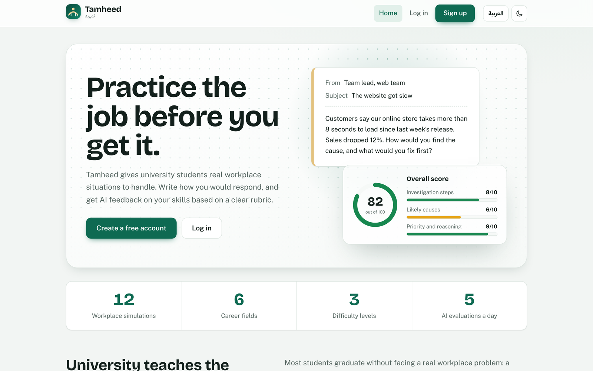
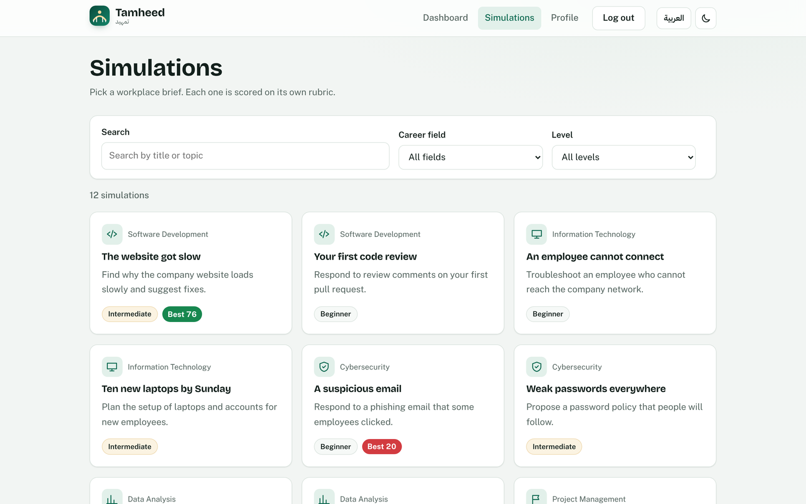
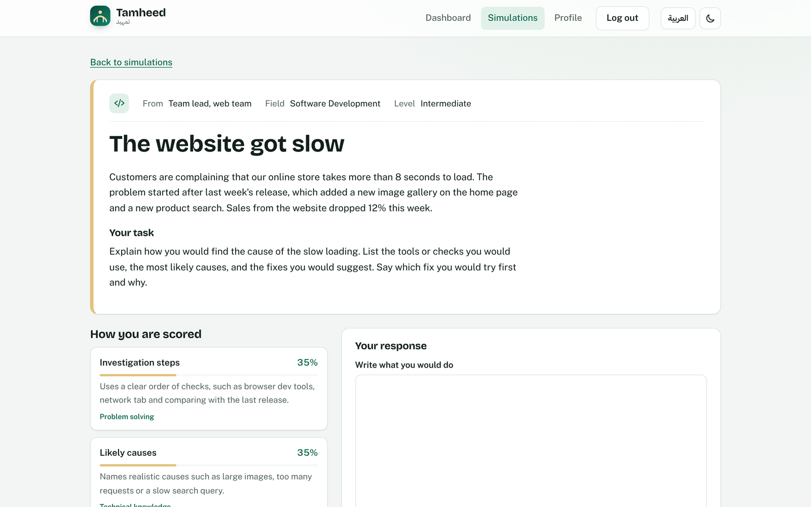
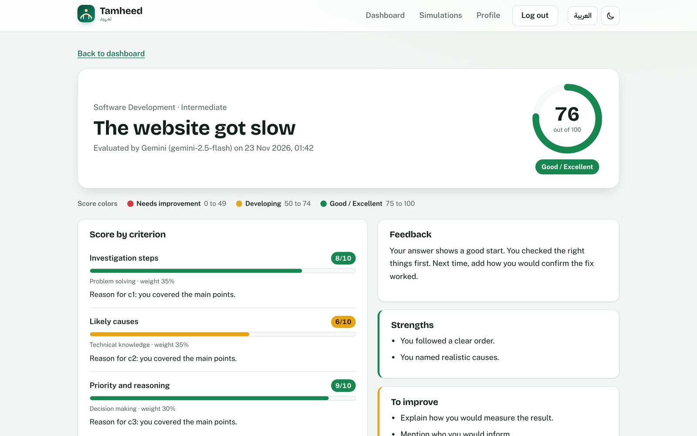
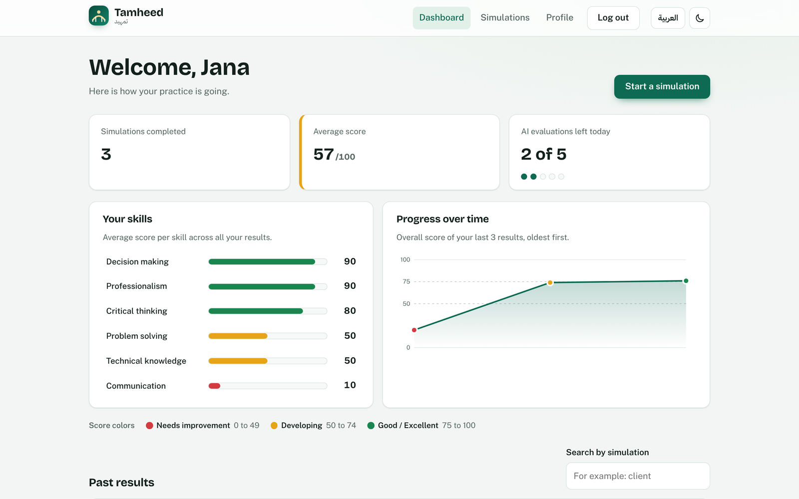

# Tamheed (تمهيد)

Tamheed is a web platform where university students practice real workplace situations. A student reads a work brief, writes how she would respond, and gets AI feedback from the Gemini API. The feedback is scored against a fixed rubric for each scenario.

CPIT405 group project, King Abdulaziz University.

| Name | Student ID | Role |
| --- | --- | --- |
| Atheer Alsulami | 2307149 | Project Manager |
| Jana Bawazir | 2305775 | Frontend Developer |
| Reham Alwegdani | 2308074 | Backend Developer |
| Asalah Munahir | 2305872 | Documentation & Testing Lead |

Roles were assigned at random. The course guidelines describe teams of 2 to 3 students and our team has four, so we will confirm this with the instructor.

## Features and course requirements

| Course requirement | Where it is in the app |
| --- | --- |
| User authentication | Sign up, log in and log out with Firebase Authentication (`src/contexts/AuthContext.jsx`) |
| Profile management | Change name and password on the Profile page |
| Protected routes | `ProtectedRoute` sends logged-out users to `/login`. `AdminRoute` opens the admin panel only for admins |
| Role-based access | Student and Admin roles, saved in the database and checked by the Firestore security rules |
| External API | Gemini API evaluates answers (`src/services/gemini.js`) with loading, error messages and result display |
| Form validation | Every form (`src/utils/validation.js`) |
| Search and filtering | Simulations page, dashboard results, admin users list |
| Loading indicators and messages | `Loader`, `Alert` and toast messages on every request |
| Data persistence | Cloud Firestore (Firebase's database), see `src/services/db.js` |
| Responsive design | Works from 360 px phones up to desktop |
| Accessibility | Labels on all inputs, keyboard focus, skip link, screen reader roles, reduced motion |

### Interface

- Full Arabic and English interface. Arabic switches the whole layout to right to left.
- Light and dark mode. The chosen language and theme are saved in the browser.
- Score colors are the same everywhere and in both themes: red 0 to 49 (Needs improvement), yellow 50 to 74 (Developing), green 75 to 100 (Good / Excellent).
- Dashboard charts: average score per skill and progress over time (plain SVG, no chart library).
- Gemini writes the feedback in the language the student is using. Students can answer in Arabic or English.

### Admin panel (`/admin`)

- **Overview:** number of users, active users, evaluations and suspended accounts, evaluations per day, results by level, most practiced simulations, platform skills, latest evaluations and the admin activity log.
- **Users:** search, filter by role and status, sort, and export users or results as CSV files.
- **One user:** profile, numbers, skills and results. Actions: suspend or reactivate, make admin or student, reset the daily limit, send a password reset email, delete all results.
- **Simulations:** add, edit, hide and remove simulations for everyone. Reset brings a built-in simulation back to its original text.
- **Settings:** the daily AI limit per student and an announcement shown on every student's dashboard.

## Screenshots

The screenshots come from a test run with sample data.

| Home | Simulations |
| --- | --- |
|  |  |

| A simulation | A result |
| --- | --- |
|  |  |



## How it works

React runs in the browser and talks to three services directly. We do not run our own server.

- **Firebase Authentication:** sign up, log in, log out and password changes.
- **Cloud Firestore:** all data. The rules in `firestore.rules` check the role and status of the user on every request.
- **Gemini API:** evaluates the answer.

An evaluation works like this:

1. The app checks the answer (100 to 3000 characters) and the daily limit.
2. `evaluateAnswer` in `src/services/gemini.js` sends the scenario, the rubric and the answer to Gemini. It asks for JSON that follows a schema and stops waiting after 30 seconds.
3. `validateEvaluation` in `src/utils/scoring.js` checks that every criterion has a score from 0 to 10.
4. `calculateOverall` computes the overall score from 0 to 100 with the rubric weights. Gemini never decides the overall score.
5. The result is saved in Firestore and shown to the student.

## API

### Gemini request

```
POST https://generativelanguage.googleapis.com/v1beta/models/{VITE_GEMINI_MODEL}:generateContent
Header: x-goog-api-key: {VITE_GEMINI_API_KEY}
Body: systemInstruction, contents (scenario, task, rubric, answer), generationConfig
      (temperature 0.2, responseMimeType application/json, responseSchema)
```

### Gemini reply (inside `candidates[0].content.parts[0].text`)

```
{
  "criteria": [{ "criterion_id": "c1", "score": 7, "reason": "..." }],
  "strengths": ["..."],
  "improvements": ["..."],
  "feedback": "...",
  "recommendations": ["..."]
}
```

Errors (no key, timeout, network, quota 429, other HTTP errors, empty or wrong reply) are shown to the student in Arabic or English, and the answer stays in the box.

### Internal services

- `src/services/gemini.js`: `evaluateAnswer`, `buildPrompt`
- `src/services/db.js`: users (`loadOrCreateProfile`, `getAllUsers`, `updateUserByAdmin`, ...), daily limit (`usedToday`, `addUsage`), results (`saveResult`, `getUserResults`, ...), simulations, settings and the admin log

## Database (Cloud Firestore)

| Collection | Document id | Main fields |
| --- | --- | --- |
| `users` | Firebase Auth uid | `name`, `email`, `role` (student or admin), `status` (active or suspended), `usage` {`date`, `count`} |
| `results` | automatic | `uid`, `simulationId`, `answer`, `language`, `model`, `criteria`, `overall`, `strengths`, `improvements`, `feedback`, `recommendations`, `createdAt` |
| `simulations` | simulation id | admin changes only (new, edited or hidden simulations) |
| `settings` | `platform` | `dailyLimit`, `announcement` |
| `adminLog` | automatic | `adminUid`, `adminName`, `action`, `target`, `createdAt` |

The 12 built-in simulations live in `src/data/simulations.js` and `src/data/simulations-ar.js`, not in the database.

## Setup

You need Node.js 20 or newer.

### 1. Install

```
npm install
```

### 2. Firebase Authentication

1. Go to https://console.firebase.google.com and create a project (the free Spark plan is enough).
2. Open Project settings, scroll to "Your apps" and register a web app.
3. Open Authentication, click "Get started" and enable Email/Password.
4. Copy `.env.example` to a new file named `.env`.
5. Copy each value of the `firebaseConfig` object into the matching `VITE_FIREBASE_...` line.

### 3. Cloud Firestore (the database)

1. In the Firebase console open **Build > Firestore Database** and click **Create database**.
2. Choose a location near you and start in **production mode**.
3. Open the **Rules** tab, delete what is there, paste the whole content of `firestore.rules` from this project and click **Publish**.

Without step 3 every page shows a permission error.

### 4. Gemini API key

1. Go to https://aistudio.google.com and sign in.
2. Open **Dashboard > API keys** and create a key. Do not add billing.
3. Check that the **Billing Tier** column says **Free tier**.
4. Put the key in `.env` as `VITE_GEMINI_API_KEY`.
5. Set `VITE_GEMINI_MODEL` to a model your key can use. The default is `gemini-3.1-flash-lite`.

### 5. First admin account

The email `admin@tamheed.com` becomes an admin the first time it logs in. To use another email, change it in **both** places:

- `src/data/admins.js`
- `firestore.rules` (the `isStartingAdmin` function), then publish the rules again

After that, an admin can make other users admins from the admin panel.

### 6. Run

```
npm run dev
```

Open http://localhost:5173/tamheed/

## Deployment

The project is not deployed publicly. We run the demo locally with `npm run dev`.

The built JavaScript contains the Gemini key from `.env`. When we tried `npm run deploy`, GitHub push protection found the key and blocked the push. Nothing was published. Please do not allow the secret in GitHub. Public hosting is planned after the Gemini call moves to a server function that keeps the key secret.

The `deploy` script (GitHub Pages) is kept in `package.json` for that later step.

## Folder structure

```
docs/screenshots/      Screenshots used in this README
firestore.rules        Database security rules (paste into the Firebase console)
src/
  firebase.js          Firebase setup: Authentication + Firestore
  App.jsx              All routes, including the nested /admin routes
  main.jsx             Entry point
  contexts/            AuthContext.jsx (user, profile, role, settings)
                       PreferencesContext.jsx (language, theme, t() for translations)
                       ToastContext.jsx (success messages)
  i18n/                en.js and ar.js: every interface text in both languages
  services/            db.js (all Firestore work), gemini.js (prompt and Gemini request)
  components/          Shared parts: routes guards, navbar, logo, score bars and ring,
                       charts, cards, loaders, alerts, form fields, useAsync hook
  pages/               Student pages
  pages/admin/         AdminLayout, AdminOverview, AdminUsers, AdminUserDetail,
                       AdminSimulations, AdminSettings
  utils/               validation.js, scoring.js, localize.js, csv.js, AppError.js
  data/                simulations.js (12 scenarios), simulations-ar.js (Arabic text), admins.js
  styles/              global.css (colors for both themes), layout.css, components.css, pages.css
```

## Known limits

- Deleting a Firebase login account needs a server, which the free plan does not offer. The admin panel suspends accounts instead. To delete an account completely, use the Firebase console: Authentication > Users.
- The daily AI limit is checked in the app. The security rules stop suspended users from saving results.
- The Gemini key is inside the built JavaScript, so anyone who opens the site could find it. This is the same as the external API example in the React lecture. For this reason the site is only run locally (see Deployment). The key is on the free tier with no billing, and you can create a new key in AI Studio at any time.
- On the free tier, Google may use the prompts to improve its products. The app sends only the scenario, the rubric and the answer, never names or emails.
- Simulations that the admin adds or edits are shown in the language the admin wrote them in.
- AI feedback is educational guidance, not an official job assessment.
